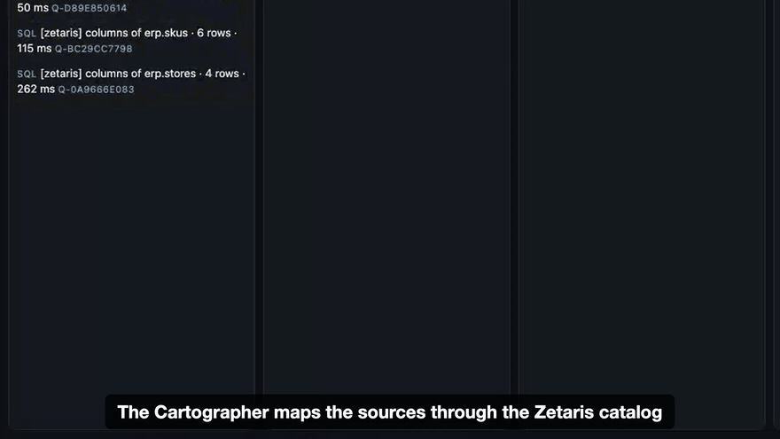

# RecallWhy

[](https://github.com/mikey92/recallwhy/actions/workflows/ci.yml) **Live site, no install:** https://mikey92.github.io/recallwhy/ (replay a live run, open the reports)

**Demo video (3:52):** https://iframe.mediadelivery.net/embed/778121/e5a6cb64-c2e7-4468-9f69-4c2d0988611f · **Slides:** [deck/RecallWhy-deck.pdf](deck/RecallWhy-deck.pdf)

**Open Agent Hackathon 2026 · Track 1: Solving Fragmented Intelligence.** RecallWhy helps a retailer's product-safety manager answer, for every new federal recall, *is it on our shelves, which lots, which stores, who bought it*, by discovering and reconciling four sources that disagree (two live federal feeds, the ERP and the supplier portal) through Zetaris. When the sources disagree, both sides are recorded as World Model facts with the query behind them, and the agents either prove a rule that reconciles them or send the case to a person. **The food items in the retailer's catalog are real products** — real titles, barcodes and brand owners from USDA FoodData Central and Open Food Facts, including every product whose barcode an FDA notice prints — and its 24 stores stand at real SNAP-authorized supermarket addresses (USDA FNS); only stock, sales and ship notices are synthetic, because no public data holds per-store lots, sales or supplier ship notices. And the answer ends in work the safety team can hand on: a pull list per store and lot, a supplier request and a customer notice, drafted for approval and never sent on their own.

Retailers get this wrong today. In December 2025 the FDA sent warning letters to Kroger, Albertsons, Target and Walmart: recalled ByHeart infant formula was still on shelves in over 175 locations across 36 states, in one case for more than three weeks. Store associates cited not knowing about the recall, "confusion regarding which specific lots were affected", and not removing all the affected product ([FDA](https://content.govdelivery.com/accounts/USFDA/bulletins/4000713), [Food Safety News](https://www.foodsafetynews.com/2025/12/fda-warns-retailers-who-failed-to-pull-recalled-byheart-formula/)).

**What RecallWhy changes:** over 322 recall/SKU pairs from 515 notices, on an item master whose food lines are real products, the agents settle 292 (91%) without a person, 290 of them correctly, and send 30 to a reviewer with the reason; 134 of 146 recalled items are caught, with 1 missed and 1 false alarm (rules alone: 89). See [Evaluation](#evaluation).

**See it without running anything:** the five agents working live (the Auditor sends back ship-notice rows the barcode map cannot reach, and the Cartographer proves a supplier rule and corrects the map), and finished reports from real runs with live Zetaris and Nemotron 3 Ultra in [`examples/output/`](examples/output/): each with its action packets and weekly digest (open `report.html` in a browser, or [view one on the live site](https://mikey92.github.io/recallwhy/examples/example_1/report.html), or [replay its trace](https://mikey92.github.io/recallwhy/replay.html?run=example_1)). And [try the review screen](https://mikey92.github.io/recallwhy/review.html) on the recorded queue and action packets, no install: decide the matches the Auditor would not settle and approve packets (nothing is sent; clicks stay in your browser).




A retailer's safety team gets dozens of federal recall notices a week. For each one they need to know: *do we sell this, which lots, which stores still have it, how many customers bought it — and why do we believe that?* Today that means hand-checking the recall feed against the ERP and the supplier portal.

The answer is spread over four systems that were never meant to meet: two federal feeds (REST), the ERP and the supplier portal (two Postgres databases), each with its own way of writing a product. RecallWhy is a team of five agents that first maps those fragments through **Zetaris** (what tables exist, which identifier columns are really the same key, and where they disagree) and then investigates every new CPSC and FDA recall across them with federated SQL. For each recall it returns an evidence-backed action brief, a "not ours" with the reason, or an escalation to a human when the evidence isn't strong enough. Every number in a brief traces back to the SQL query that produced it. Every claim about the notice traces back to words that are literally in the notice.

```
 live CPSC feed ─┐  (Zetaris Lightning REST tables)
 live FDA feed  ─┤
                 ├── Zetaris ── federated SQL ──┐
 ERP (Postgres) ─┤  (JDBC datasources)          │
 supplier portal ┘                              ▼
  Cartographer ──► Scout ──► Investigator ◄──critique── Auditor ──► Briefer ──► brief.md
  (catalog, join tests) ◄──── barcode rows its key can't reach ──┘
       └── corrected map (per-supplier rule) ──────────────────►
                   │   ▲  (≤2 revisions, then human queue)  ▲
                   ▼   │                                    │
           H-MEM (decisions, trust)      World Model (facts + provenance) ─┘
                   ▲
             human `decide`
```

## Agents

| Agent | Does | Can |
|---|---|---|
| **Cartographer** | Before any case: lists every Zetaris datasource, Lightning database and schemastore view, describes their columns and tags barcode, SKU and lot columns. Profiles barcode lengths and tests each cross-source barcode join as written and without leading zeros. Finds that a third of the suppliers send GTIN-14 (UPC-12 padded with `00`): 6,810 of 14,244 barcoded ship notices join as written, 11,809 after stripping leading zeros (on Zetaris; 11,512 on the DuckDB stand-in). The other 2,435 join neither way; it says so and leaves them open. When the Auditor sends back rows its key cannot reach, it diagnoses that supplier's barcodes, tests the fix on **every** ship notice from that supplier, and only then corrects the map (for example: SUP028 sends the 11-digit UPC without its check digit, 391 of 391 rows). On Zetaris the corrected map is then written back as a schemastore view, `reconciled.ship_notice_item_keys` (ship notices matched to our items under the proven rules), and each learned supplier is read back from it in a separate query before the rule counts; any Zetaris user can query the reconciled join. Zetaris then checks the result with its own tools: `INFER SQLTABLE SOURCES` gives the view's lineage (supplier portal ship notices + ERP items), and a USL table refreshed from the view carries a data-quality rule, `barcode_names_the_notice_sku` (every barcode match must name the notice's own SKU), which `RUN DQ` reports as all rows valid, 0 invalid, in every live run (set up once by `npm run setup:zetaris`, `sql/03_writeback.sql`). For a format it has no rule for, the model proposes a transform from sampled pairs in a fixed op set and SQL proves it on all rows (four suppliers send a 10-digit core: for each, Nemotron 3 Ultra proposed a transform such as `drop_first:1 → drop_last:1` on our UPC, which held on every one of the supplier's ship notices, 193 to 390 rows). It also profiles the live feeds: the FDA feed has no barcode field (92 of 333 notices print one in the product text, 50 more only once spaces and dashes are removed) and writes dates as `yyyymmdd`; CPSC has a UPC field on 4 of 189 notices and writes ISO dates. Skips the Zetaris sample databases with the reason logged. | Tell the Auditor which join to trust; correct the map mid-run |
| **Scout** | Pulls recalls since a date from the two live feed views. Loads the item master. Runs one federated query that joins the live FDA feed (REST) with ERP SKUs (JDBC) on UPC digits. Opens a case for each recall that touches our catalog. | Delegate cases to the Investigator |
| **Investigator** | Reads prior decisions from H-MEM. Decides each candidate: UPC or model number → rule; text match → **NVIDIA Nemotron** judge, which must quote the notice. Reads lot codes (regex plus Nemotron). Computes exposure with federated SQL: on-hand units by store and lot, units sold since the recall date, loyalty customers to notify, and the supplier from ship notices. | Revise when the Auditor blocks it |
| **Auditor** | Re-checks each UPC match against the *live notice in Zetaris*. Checks that judge quotes and lot codes are verbatim in the notice, and that every product word of our item appears in the notice (catches "cheese pizza" ≠ "pepperoni pizza"). **Re-derives every exposure number with its own SQL**, aggregated in the database rather than in code. Confirms affected lots against supplier ship notices, reached by barcode (a different key than the Investigator's SKU join). If the barcode reaches fewer lots than the SKU, it sends those rows to the Cartographer rather than blocking the Investigator, which could not fix a key format. Rejects briefs that cite missing evidence or state numbers not in the evidence. | **Block** (max 2 revision rounds, then escalate to the human queue) |
| **Briefer** | Writes the brief only from the World Model context builder (numbered evidence with provenance). Nemotron writes the "why" paragraph; the Auditor checks it. Actions and caveats are computed. | Fall back to a template if the model's draft keeps failing the check |

Every message, SQL call, model call, memory read/write and world write goes to `logs/trace-<run>.jsonl` and stdout. Traces come only from the code path; nothing is hand-written.

## What the safety team gets

For every run, in `out/<run>/`:

- **A brief per recall** (`briefs/`, and `report.html` with each case's trace): the verdict, why (every claim cited to a World Model fact and the SQL or model call behind it), what we matched and how, and caveats.
- **A map of where to pull** (top of `report.html`, `src/store-map.ts`): every store in the run's pull lists at its real location, sized by units, with the selected recall notice's own distribution states shaded. A store in a state the notice does not list is marked: the stock got there through a distributor, which a check by distribution list alone would miss. Inline SVG (US Census state outlines via us-atlas, `data/geo/`), no network needed.
- **An action packet per recall with our stock or sales** (`actions/<case>/`, `src/actions.ts`): `pull-list.csv` (one row per store and lot, with the store's name and city), `supplier-request.md` (a credit and replacement request that cites the supplier's own ship notices by ASN, one per supplier) and `customer-notice.md` (the notice for loyalty customers who bought affected lots: a count, the loyalty system resolves who). Each comes from its own federated query; **the pull list is withheld unless it adds up to the on-hand number the Auditor re-derived** with its own SQL. They are drafts: approving one on the review screen (`/review`), with `npm run approve -- <run> <case>` or `POST /approve` records who approved it and when. Nothing is sent.
- **A weekly digest** (`digest.md`, `src/digest.ts`): what needs the manager first, most urgent first, and a table of every case. It is read through the **Meterless Markovian engine**: the cases go in batches of a fixed size, one bounded chunk each, and only a compressed state is carried from chunk to chunk, so a run with 200 cases costs the same per call as one with 10. Totals and the table are computed in code; the Auditor drops the model's lines if they state a number no case has.

## How the sponsor technology is used

**Zetaris (load-bearing: every agent reads data only through it)**
- `sql/01_feeds.sql` registers two live **Lightning REST tables**:
  - saferproducts.gov CPSC recalls. Its response is a top-level JSON array, which Zetaris accepted; the getting-started notes listed that shape as untested.
  - api.fda.gov food enforcement.

  Both are flattened into schemastore views (`recallfeeds.cpsc_recalls`, `recallfeeds.fda_food`). REST tables re-fetch on query, so each run reads the feeds as they are at that moment.
- `sql/02_retail_sources.sql` registers the synthetic ERP and supplier-portal Postgres databases as two **JDBC datasources**.
- Agents run federated queries across REST × JDBC (the Scout's UPC sweep, the Auditor's UPC re-check against the live notice) and JDBC × JDBC (ship notices ⋈ ERP item master).
- The Auditor verifies the Investigator by **querying Zetaris again with differently written SQL**.
- `scripts/setup-zetaris.ts` sets all of this up through the Zetaris REST API (`/api/proxy/sql-editor/sqls/run-query`, with `X-Org-ID` and a fresh `X-Request-ID` per call).

**Meterless agent engines** (mounted from [github.com/Meterless/Meterless](https://github.com/Meterless/Meterless), Apache-2.0, see `src/engines/*/NOTICE`). Engine tests: `npm test` (run by CI on every push, with `npm run check:repro`, which re-runs the model-free evaluations and compares every pair with the committed results, and `npm run check:claims`, which recomputes every number in this README, EVAL, metadata, the deck and the site from `eval/results/` and the example traces) runs `test/engines.test.ts` (H-MEM: a human decision survives a restart and changes the next session's decision; human decisions outrank agent decisions; World Model: one id per entity, facts persist with provenance, the Briefer's context cites them).
- **H-MEM** (`src/engines/hmem`, wrapper `src/memory.ts`): every adjudication is stored: the agents' in working memory at confidence 0.6, humans' (`npm run decide`) in long-term memory at 0.95. Decisions in a case that was escalated, and UNSURE calls, are not stored as the agents' answer; the reviewer's decision is. Before judging, the Investigator reads the exact prior decisions for that recall/SKU pair plus similar past cases. A human decision is followed and cited in the brief. The trust ledger records every write and every read, including the exact prior-decision lookup.
- **Markovian** (`src/engines/markovian`, used by `src/digest.ts`): the weekly digest is a Markovian chain over every case of the run, in chunks of at most 7 cases with a carryover of at most 256 tokens (`chunkSize` 2000, `maxChunks` 32); the run record's chunk count, status and estimated token savings go into the trace and the digest's footer. Tested in `test/actions.test.ts` (40 cases in at least 6 chunks, every prompt bounded, later chunks see only the carried state, and model lines with an invented number are replaced).
- **World Model** (`src/engines/world-model`, wrapper `src/world.ts`): recalls, cases and findings are entities and facts. Every write carries provenance: source kind, agent, and the SQL id or model call. Our context builder (`buildContext()` in `src/world.ts`) reads the engine's fact view, and it is the **only** input the Briefer sees, so a brief can only cite what the team actually established.

**Meterless Nightshift (primary AI provider)**: every model call goes through one injected generator (`src/llm.ts`) to Nightshift's OpenAI-compatible Runtime API on the same machine (`http://127.0.0.1:8088/v1`, with `meterless-app` and `meterless-scope` headers; the runtime token is read from Nightshift's own token file or `METERLESS_RUNTIME_TOKEN`). The NVIDIA key lives in Nightshift's provider store, not in this repository. Each `llm` trace event records the requested model, the model Nightshift actually routed to (`served_model`) and its receipt id; the live viewer and the report show `requested ⇒ served` per call. Transient errors (429, 502–504, first-token timeouts) are retried with backoff and logged as `llm.retry`. Calls to `nvidia/*` models are paced to 4 a minute (a burst of 4, then one every 15 s), about what the hosted endpoint allows, so a long run waits between calls instead of collecting 429s; `LLM_RPM` changes the rate and `0` turns pacing off.

**NVIDIA Nemotron**: `nvidia/nemotron-3-ultra-550b-a55b`, called through Nightshift, is the default model. It judges text matches (and must quote the notice), reads lot codes out of messy `code_info` text, and writes the why-paragraph that the Auditor checks. `nvidia/nemotron-3.5-lightning-30b-a3b` was also evaluated through Nightshift. Ollama (`LLM_PROVIDER=ollama`) and any other OpenAI-compatible endpoint (`LLM_PROVIDER=openai`) remain available as alternatives.

**Cursor**: the repository was developed in Cursor. The Cursor agent scaffolded it and wrote these parts, each reviewed and corrected before committing (commits marked "Cursor agent"):
- the synthetic retailer generator and Postgres loader
- the Zetaris REST runner, plus its retry and type handling (I fixed its UPC-to-number coercion bug)
- the DuckDB sample-mode runner with its Spark→DuckDB dialect shim
- their tests

Other AI coding assistants were also used; every change was reviewed by me.

## Run it

**Quickest look, no credentials (about 5 seconds):** `npm ci && npm run demo`, then open `report.html` in the `out/<run>/` folder it prints. Same agents and SQL on the DuckDB stand-in, no model, so text matches go to the review queue. The live runs are on the [site](https://mikey92.github.io/recallwhy/).

Requirements: Node 22+, Docker, Meterless Nightshift with an NVIDIA provider key (or Ollama / any OpenAI-compatible endpoint), and a Zetaris instance for live mode.

```bash
npm install
cp .env.example .env          # fill in Zetaris and Postgres settings
docker compose up -d && npm run load     # synthetic ERP + supplier portal
npm run setup:zetaris                    # register feeds + datasources in Zetaris
# Nightshift running, NVIDIA key added under Setup ▸ Providers (LLM_PROVIDER=meterless is the default)
npm run agents -- --since 2026-09-15 --limit 5   # about 3 minutes; → out/<run>/report.html + report.md, briefs/, logs/trace-<run>.jsonl
npm run view                             # http://127.0.0.1:8899 — watch the five agents live, open reports;
                                         # /review — decide escalated cases (stored in H-MEM, followed next run)
```

Real outputs from these commands, with their traces, are in [`examples/`](examples/): a live Zetaris run, the human review step, the re-run that follows the human decision, and a sample-mode run.

**API and Docker** (what a judge or another program calls):

```bash
docker build -t recallwhy . && docker run --rm -p 8000:8000 -e SAMPLE_MODE=true recallwhy
curl -X POST localhost:8000/run -H 'Content-Type: application/json' -d @examples/input/example_1.json
curl localhost:8000/runs/<runId>/trace     # the run's JSONL trace
curl localhost:8000/runs/<runId>/report    # its HTML report
```

With live Zetaris and Nightshift, pass the same `.env` and point the container at the host. Inside a container `localhost` is the container itself, and the Nightshift token file is not mounted, so the token goes in `METERLESS_RUNTIME_TOKEN`:

```bash
docker run --rm -p 8000:8000 --env-file .env \
  -e METERLESS_BASE_URL=http://host.docker.internal:8088/v1 \
  -e ZETARIS_BASE_URL=http://host.docker.internal:3000 \
  recallwhy
# If another app holds port 3000 on the host, join Zetaris's network instead:
#   --network zetaris_default -e ZETARIS_BASE_URL=http://zetaris-ui-1:3000
```

`POST /run {since, only?, limit?}` returns the verdict per case, the briefs, the engine (`zetaris` or `duckdb-sample`) and the model. Inputs are validated (bad dates, limits outside 1–50 and non-list `only` get a 400), and one run happens at a time (409 while busy). Without Nightshift or Zetaris the container still answers, in sample mode with rules only. If Zetaris is configured but does not answer, the run falls back to sample mode and the trace says why (`ZETARIS_FALLBACK=false` makes it fail instead). `examples/input/` has three request bodies. `npm run api` starts the same server without Docker. The API listens on 127.0.0.1 unless `HOST` is set (the container sets `HOST=0.0.0.0`); set `API_TOKEN` to require `Authorization: Bearer <token>` on every POST. POSTs must be JSON (64 KB at most), and `/decide` only accepts pairs that are in the review queue.

**No credentials? Sample mode:**

```bash
SAMPLE_MODE=true npm run agents -- --since 2026-09-15 --limit 10
```

The same agents and the same SQL run against an in-process DuckDB stand-in, over feed snapshots in `sample/` (captured at the time in `sample/CAPTURED_AT`) and the synthetic CSVs. Output is labelled `duckdb-sample`; Zetaris is not used in this mode. With `LLM_PROVIDER=none` the agents still run: text matches go to the human queue, and briefs use the template.

**Human in the loop and memory across runs:**

```bash
npm run queue                                           # escalated cases
npm run decide -- H-1259-2026 NW-100058 same --note "same rice balls as the notice"
npm run agents -- --since 2026-07-01 --only H-1259-2026 # Investigator follows the stored decision
```

The same through the API, in the container with no credentials:

```bash
curl -X POST localhost:8000/run -H 'Content-Type: application/json' -d '{"since":"2026-07-01","only":["H-1259-2026"]}'   # needs-human
curl localhost:8000/queue                                                                                                 # why it needs a reviewer
curl -X POST localhost:8000/decide -H 'Content-Type: application/json' -d '{"recall":"H-1259-2026","sku":"NW-100058","verdict":"same"}'
curl -X POST localhost:8000/run -H 'Content-Type: application/json' -d '{"since":"2026-07-01","only":["H-1259-2026"]}'   # act-now, following the decision
```

## Failure handling

| Failure | What happens | Where |
|---|---|---|
| Zetaris configured but not answering | The run falls back to the sample stand-in; the trace has the `sql.error` and a note saying why (`ZETARIS_FALLBACK=false` to fail instead) | `src/sql/index.ts` |
| A live feed is down (openFDA answers 500 at times; it did during this build) | The Scout reports it and goes on with the other feed; the Cartographer keeps the map without the feed profile | `src/agents/scout.ts`, `cartographer.ts` |
| No Zetaris credentials, or `SAMPLE_MODE=true` | Same agents and SQL on the DuckDB stand-in, labelled `duckdb-sample` | `src/sql/duck.ts` |
| Nightshift 429, 502–504, first-token timeout | Retried after 3, 8, 20, 45 and 90 s (the hosted NVIDIA limits are per minute), each retry logged as `llm.retry` | `src/llm.ts` |
| Model call still failing, or no token | The judge answers UNSURE and the pair goes to the human queue; lot reading falls back to the regex; the Briefer uses its template | `src/agents/investigator.ts`, `briefer.ts` |
| Model claim not supported by the notice or the data | The Auditor blocks it and sends a critique; after 2 revisions the case is escalated to a human | `src/agents/auditor.ts` |
| Bad request to `POST /run` | `400` with the reason; `409` if a run is already going | `src/api.ts` |

## Evaluation

`eval/run.ts` runs the real Investigator ⇄ Auditor loop (sample-mode data, model calls through Nightshift) on every candidate pair since 2026-07-01: 515 recalls scanned, 184 cases, 322 recall/SKU pairs, 146 of them covered. A pair counts as covered if our item is the product the notice recalls: for food, the real product whose barcode the notice prints (97 pairs); for non-food, the SKU built from that CPSC notice (49). The 176 others are mostly real products of the same brand owners (another flavour, size or line of the recalling firm), the hard negatives a real item master is full of.

| Judge model | Covered caught (of 146) | Wrongly dismissed | False alarms (of 176) | Sent to human | Model calls failed after retries |
|---|---|---|---|---|---|
| none (rules only) | 89 | 0 | 0 | 233 | — |
| **NVIDIA Nemotron 3 Ultra 550B, through Meterless Nightshift** (default) | **134** | **1** | **1** | 30 | 0 of 392 |

With Ultra the agents settle **292 of 322 pairs (91%) without a person, 290 of them correctly**, and send 30 to a reviewer with the reason. Every food recall whose barcode we carry is caught by the UPC rule, re-checked against the live notice by the Auditor; the judge's work is the 223 text pairs: CPSC items without barcodes, and same-brand products that are not the recalled one.

**What the Auditor adds** (text matches only, 223 pairs, 47 covered; "first answer" is the judge's first reply in the same trace):

| | Caught | Wrongly dismissed | False alarms | Sent to human |
|---|---|---|---|---|
| Ultra, judge's first answer | 43 | 4 | 2 | 0 |
| Ultra, after the Auditor loop | 45 | **1** | **1** | 20 |
A dismissed recall is the dangerous error: recalled stock stays on the shelf. The Auditor checks dismissals as well as matches: a dismissal whose own quote names every product word of our item is sent back to the judge, and one whose quoted recalled product differs from ours only in size, count or description (`dismissal-same-line`: "Pico" against "Pico De Gallo Mild", 18 eggs against a notice for 12) goes to a person; another flavour of the same brand stays dismissed. Details and caveats: [`eval/EVAL.md`](eval/EVAL.md).

**Cartographer ablation** (the judge is off, so no model reads a notice; same 322 pairs):

| Setup | Covered caught (of 146) | Sent to human | Cartographer corrections |
|---|---|---|---|
| No Cartographer: barcodes join as written, no loop | 53 | 269 | — |
| Map only on demand: no upfront map, the Auditor sends every mismatch back | 89 | 233 | 15 rules from cases (11 padding, 4 check digit); the four 10-digit suppliers left unexplained |
| Upfront map + loop, known transforms only | 89 | 233 | padding found upfront, 4 check-digit rules from cases; the four 10-digit suppliers left unexplained |
| **Upfront map + loop, model proposes, SQL proves** (default) | **99** | 223 | the 4 check-digit rules, plus 4 transforms Nemotron 3 Ultra proposed and SQL proved on every ship notice of the supplier (193, 339, 373, 390 rows) |

Four suppliers send a 10-digit core (no leading digit, no check digit), a format the code has no rule for. The Cartographer samples six barcode pairs from the supplier with SQL and asks the model for a transform in a small DSL (`digits_only`, `strip_leading_zeros`, `drop_first:N`, `drop_last:N`, `take_first:N`, `take_last:N`; nothing else is accepted, no free SQL). The prompt also carries where one code's digits sit inside the other's, computed by the code. The proposal is compiled to SQL and adopted only if it holds for every ship notice from that supplier; if SQL rejects it, the model is shown the rows where it failed and gets one more try; the World Model fact keeps the ops, the model and the SQL id. Ultra proposed `drop_first:1 → drop_last:1` for our UPC against the supplier's digits (or `take_last:10` on theirs), and it held on all rows. Without the Cartographer, every GTIN-14, check-digit or 10-digit supplier looks like a lot that was never shipped, so the Auditor blocks real matches. Files: `eval/results/none-none*.json` (`none-none-map-…` is the row with model proposals: judge off, Cartographer on Ultra).

**Real products, text only** ([`eval/REAL.md`](eval/REAL.md)): the same 95 real products and 97 recall pairs, plus 152 real hard negatives (the closest other notice, and other products of the same brand owner). On the barcode path the Scout and Investigator settle **97 of 97 by the UPC rule with no model call**, the Auditor's re-check finds the barcode in the notice for 97, and **0 of 152 negatives** are matched. With every barcode hidden, the text judge plus Auditor catches 55 of 97, misses 23, raises 2 false alarms in 152 and sends 31 to a person: the text path is a safety net, not the main road.

## Data

- **Live**:
  - CPSC SaferProducts Recall API (U.S. government work)
  - openFDA food enforcement API (open.fda.gov terms; CC0). openFDA's disclaimer applies: do not rely on it for medical decisions.
- **Real products** (`data/real/`, licences in `data/real/README.md`): the retailer's food lines.
  - Every product whose barcode an FDA notice in the snapshot prints, found in USDA FoodData Central Branded Foods (CC0) or Open Food Facts (ODbL): 95 products, 97 recall pairs (`scripts/build-real-catalog.ts`).
  - Other products of the same brand owners (86 after one line per barcode): the "same vendor, different product" lines a real item master is full of.
  - A seeded FoodData Central sample for the rest of the food aisles (260 products no notice prints and no recalling firm makes; `scripts/build-real-shelf.ts`).
- **Real stores**: the 24 Northwind stores stand in the cities of real SNAP-authorized supermarkets — two active supermarkets per state, picked by a seeded hash from the USDA FNS SNAP Retailer Locator (703,441 records, US federal data, public domain) by `scripts/build-real-stores.ts` into `data/real/stores.json`. The chain name stays fictional and no row names the real business at the address, because the stock and sales around it are not theirs.
- **Synthetic**: Northwind Mercantile's 900 SKUs' inventory lots, weekly sales and supplier ship notices, generated by `scripts/gen-synthetic.ts` (seeded). No public dataset holds per-store lot inventory, item-level sales linkable by barcode to FDA recalls, or supplier ship notices (EDI 856), so stock, lots, sales and ship notices are synthetic for every item; non-food items are too, because no public consumer-product catalog with barcodes exists: about 50 are built from CPSC notices so the catalog overlaps the feed, the rest are invented. About half of the recalled food items' lots carry a lot code taken from the notice.
  - Evaluation ground truth lives in `data/synthetic/eval/` and is never read by the agents.
  - There is no personal data. Loyalty customers are counts, not identities.

## Limitations

- Stock, sales, lots and ship notices are synthetic, and so are the non-food items (CPSC), whose titles are built from the notice text; the food items are real products. The barcode quirks (a third of suppliers sending GTIN-14, four sending the UPC without its check digit, four sending a 10-digit core) are planted by `scripts/gen-synthetic.ts`, modelled on real EDI feeds; the Cartographer's code does not know which suppliers they are. Real item masters abbreviate harder, and real lot codes come from receiving scans.
- A text match rests on one model reading English (Nemotron 3 Ultra by default), and the Auditor's checks are lexical: grounding, item words, lot tokens. Ambiguous cases go to a human instead of being guessed.
- The Cartographer knows two barcode transforms (leading-zero padding, a dropped check digit); for anything else the model proposes one from a fixed set of string ops and SQL proves it on all of the supplier's rows. A format those ops cannot express (a remapped prefix, a per-row lookup) is still reported as unexplained, and its rows stay with the SKU join.
- CPSC notices carry no distribution states in our feed view, so the "shipped outside the recall's distribution" caveat only fires for FDA recalls.
- The loyalty-customer count sums weekly distinct counts, so it is an upper bound.
- CPSC notices rarely print UPCs (4 of 184 in the `sample/` snapshot of 22 Oct, 4 of 189 in the live feed on 24 Oct), so CPSC matching leans on model numbers and the judge.
- The feed windows are fixed in `sql/01_feeds.sql` (2026-07-01 onward). Recalls before that date aren't read.
- Nightshift and Zetaris run locally on one Mac for this build. Hosted NVIDIA endpoints are rate-limited, so long evaluations can see 429s; those calls are retried and logged.

## Prior work and adapted code

- The matching ideas (brand gate, product-kind overlap, model-number conflict, quotes grounded in the notice) come from my own **Recall Sloth** ([github.com/mikey92/recall-sloth](https://github.com/mikey92/recall-sloth), committed 21 Oct 2026, before the build window; declared in the submission form). `src/match.ts` is new code written for this project.
- `src/engines/hmem`, `src/engines/world-model` and `src/engines/markovian` are the Meterless reference implementations (Apache-2.0), mounted unchanged except where `CHANGES.md` notes otherwise.
- Product data: USDA FoodData Central (CC0) and Open Food Facts (ODbL); see `data/real/README.md`.
- Libraries: `pg`, `@duckdb/node-api`, `tsx`, `typescript`.
